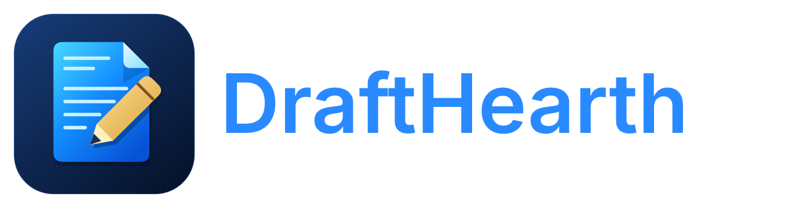

# Tavru Docs

[TavruOS interface design brief](docs/TAVRUOS-UI.md) · shared purple workspace styling

> **Product name:** Tavru Docs. Earlier public names were Qanloom, DraftHearth and Nisaba. Repository: [github.com/tomblanchard312/Tavru-Docs](https://github.com/tomblanchard312/Tavru-Docs).

<p align="center"></p>

**A fast, open-source word processor written in Rust, for documents, writing and design.** The
ribbon, styles, tables, track changes, references and mail merge; it reads and writes .docx, opens
.odt, .rtf, .html, .md and .txt, exports PDF, and can be driven by AI agents over MCP.

Tavru Docs is a fork of [WordCraft](https://github.com/storytold/wordcraft) by the ArtCraft team and
community. It follows WordCraft closely and adds what a desktop built around local AI needs:

- **Oqelith, a built-in local writing assistant**: improve, shorten, correct grammar, adjust tone or
  continue your writing. GGUF models run locally through the Oqelith daemon; document text stays on
  your computer. Suggestions become tracked changes you accept or reject.
- **A side-by-side VBA workspace**: edit modules, inspect the document model, place form controls,
  ask for coding help and review local code-completion suggestions. The optional .NET runtime
  executes supported macros against Tavru Docs's command protocol.
- **A FreeBSD and KDE Plasma home**: packaging and defaults for a FreeBSD desktop distribution,
  alongside the Linux, macOS, Windows and web builds WordCraft already has.

Tavru Docs keeps WordCraft's internal names (crates, commands, environment variables) so upstream
improvements merge cleanly. The name people see comes from
[`crates/brand`](crates/brand/src/lib.rs). The installed programs are still `nisaba` and
`nisaba-cli`. Settings stay in `~/.config/nisaba` (macOS `~/Library/Application Support/Nisaba`,
Windows `%APPDATA%\Nisaba`). The application id is still `io.github.tomblanchard312.Nisaba`.
The brand crate's homepage constant still points at the previous Qanloom repository URL.

## Build and run

```sh
cargo run --release -p wordcraft -- --sample          # the desktop app with the sample document
cargo run --release -p wordcraft-cli -- convert in.docx out.pdf
```

Settings are separate from an installed WordCraft. **Help › Check for Updates** still follows the
brand homepage. Automatic updates are disabled while the upstream installer is adapted to this
fork's package identity.

## Write with Oqelith

1. Open **Ask** in the title bar. Under **Settings**, download a catalog model or choose a compatible
   local GGUF file. Downloads require internet access; inference runs locally through the Oqelith
   daemon, which Tavru Docs starts when needed.
2. Select text and choose **Improve**, **Shorten**, **Fix grammar** or **More formal**, or enter
   your own request. **Continue** can also use the text before the caret when nothing is selected.
3. Review the suggestion, then **Replace** or **Insert** it. Accept or reject the resulting edits
   through the Review tab.

Oqelith refuses stale suggestions after document edits or switches, and prevents applying stopped
or incomplete results. Model downloads show progress, support cancellation and verify pinned file
hashes. The catalog includes Qwen, Gemma, Phi-4 mini and Llama 3.2; gated models require access
through Hugging Face. Model licenses apply separately.

Oqelith currently works with selected text or nearby continuation context, with no document-wide
conversation history. Writing quality varies by model and task; review suggestions before accepting.
The assistant is available in desktop builds. See [the Oqelith guide](docs/assistant.md) for setup,
limits and commands.

## Edit VBA and automate documents

Open **Developer › Code Editor** (**Alt+F11**) beside the live document. The workspace includes:

- A project explorer, syntax-colored code, `.bas`/`.cls` import and export, and embedded `.docm`
  module editing and saving.
- A document designer with selectable document nodes and an icon-based controls toolbox. Drag
  controls onto the page, or insert at the caret, using normal document editing and undo.
- Local coding chat with bounded document/module context, and **Suggest code** for completion.
  Review generated code before inserting it; code is never automatically executed.
- Optional **Check** and **Transpile** actions using the .NET SDK. Supported macros can run through
  the CLI, including filling existing body text controls and toggling check boxes.

The VBA helper requires the **.NET 8 or newer SDK**. Compatibility is a supported subset of Word's
VBA API, developed from public specifications and documented APIs. GUI macro execution, visual
UserForms, control events and full Word compatibility remain open. The runtime's allow-list is
defense in depth, not an operating-system sandbox; run only trusted macros. Native Microsoft Word
round-trip and execution acceptance remain unverified.

See [the VBA workspace guide](docs/vba-editor.md) and [runtime setup and compatibility](vba/README.md).

Contributor rules (never crash, no Microsoft assets, clean room, quality gates) are WordCraft's and
apply here unchanged: see [CLAUDE.md](CLAUDE.md) and [AGENTS.md](AGENTS.md). The detailed feature,
format and parity documentation is in [docs/](docs/).

## License and credits

The vendored Oqelith client/protocol snapshot retains its existing `UNLICENSED` designation;
this product's license does not grant rights to that code. See [snapshot provenance](vendor/README.md).

MIT OR Apache-2.0, at your option. WordCraft is copyright (c) 2026 ArtCraft Team and the WordCraft
contributors. Fork changes are copyright (c) 2026 Tom Blanchard; the copyright line in
`crates/brand` still records those changes under the earlier Qanloom, DraftHearth and Nisaba names.
See [NOTICE](NOTICE) and [ATTRIBUTION.md](ATTRIBUTION.md) for bundled material. Tavru Docs is not
made, sponsored or endorsed by the ArtCraft Team, and contains none of the ArtCraft marks.

The icon file is still `nisaba-logo.png`: the existing blue-and-gold document-and-stylus artwork.
Icon filenames and operating-system IDs stay as they are so upgrades keep working. See
[product identity](docs/product-name.md).

Voice accessibility preview: see [dictation, transcription, translation and safe voice controls](docs/VOICE.md).
